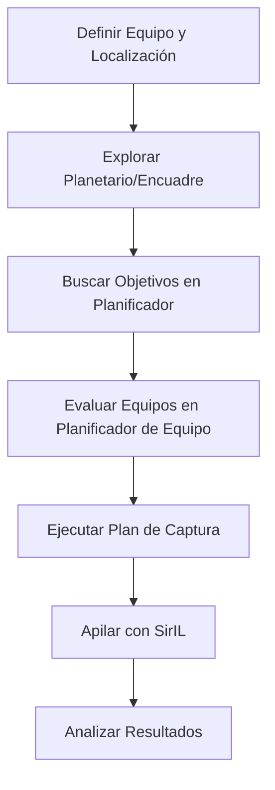

# Filosofía del Programa PASS

## 🌟 Misión y Propósito

**Planning & Astronomical Stacking Suite (PASS)** nace para cubrir un vacío significativo en el software de astrofotografía amateur:

> **El problema actual:** Existe abundante software para afilado/apilamiento (SirIL, PyRAF, etc.) y planetarios virtuales (Stellarium, SkyField, etc.), pero **NINGUNO** combina planificación integral de sesión con gestión de compras de equipo basada en métricas personalizadas por usuario.

## 🎯 Principio Central: ¿Por qué PASS?

| Área | Software existente | Vacío que cubre PASS |
|------|-------------------|----------------------|
| **Afilado/apilamiento** | SirIL, PyRAF, etc. | ✅ Ya resuelto - PASS integra SirIL |
| **Planetarios virtuales** | Stellarium, SkyField, etc. | ✅ Ya resuelto - planetario como añadido |
| **Planificación de sesiones** | Pocas opciones, poca integración | ⭐ **Núcleo principal de PASS** |
| **Comparativa de equipos** | Basado en specs técnicas puras | ⭐ **Métricas definidas por usuario** |

## 🚀 Funcionalidades Principales (Por Tabs)

### 1. **Resumen**
- **Progreso de captura por objeto**: tiempo de exposición total acumulado (lo calcula el Apilador) frente a lo planificado.
- **Sesión activa**: lee las sesiones planificadas que guardó el Planificador.
- Resumen general del equipo y planes del usuario.
- **Enfoque:** Coordinación y visión general.

### 2. **Planetario**
- Planetario virtual estilo Stellarium con **dos esferas concéntricas**: una con imágenes DSS2 (JPG del DSS2 como texturas) y otra con los puntos de los objetos.
- El usuario está en el centro y mira la esfera completa — **sin proyección rectangular** (descartada por problemas de rendimiento).
- Catálogos: **Messier, NGC, IC, LDN**.
- Encuadre, mosaicos y planificación visual.
- **Enfoque:** Visualización y decisión de encuadre.

### 3. **Equipo**
- El usuario monta sus equipos con sus ubicaciones: componentes globales (telescopio/cámara principal y de guía, montura, filtros) + ubicación, organizados por categoría (paisaje, campo amplio, espacio profundo, espacio profundo largo, planetario, general).
- **Datos fríos** guardados: apertura, distancia focal, cámara (refrigerada, resolución, profundidad de bits, nombre), montura, precio y peso.
- Imágenes adjuntas (diagramas de spot, charts, mapas de CL): el usuario las compara **visualmente**; el programa no las analiza.
- **Enfoque:** Inventario personal.

### 4. **Planificador de Equipo**
- Comparar equipos según **métricas que el propio usuario define** (nunca impuestas) y presupuesto.
- Recomendaciones: "¿este equipo me conviene más que el otro?" con explicación de los datos comparables.
- Las gráficas (spot, etc.) se muestran para que el usuario las compare por su cuenta.
- **Enfoque:** Decisiones de inversión informadas.

### 5. **Planificador** ⭐ (Corazón del programa) — 4 subpestañas
| Subpestaña | Qué hace |
|---|---|
| **Búsqueda** | Filtros → tabla del catálogo. Al seleccionar un objeto: gráfica de **tránsito** del día, separación con la **luna**, fase lunar, horas de **noche astronómica** y tarjetas de **clima/seeing**. |
| **Catálogo personal** | El usuario guarda objetos que le interesan para usarlos en planificación. |
| **Planificación** | Compara los objetos seleccionados → **ranking con recomendaciones**: cuál conviene más y buenas fechas. |
| **Sesiones planificadas** | Sesiones concretadas, guardadas en datos; **Resumen las lee** para saber en qué sesión está el usuario. |

### 6. **Apilador**
- Carga sesiones y detecta su estructura: `lights`, `flats`, `darks`, `bias`, `dark_flats` y carpeta de `masters/`.
- **Calibración automática** por sesión → salida en una carpeta de trabajo; los originales son de solo lectura.
- **Pool global** de referencias a los lights calibrados (cero copias en cadena).
- **Auditoría** con las métricas de SirIL (FWHM, redondez, transparencia): gráficas por sesión, ranking de frames y descarte de valores extremos.
- **Apilado** con todas las opciones de SirIL (drizzle, criterios de rechazo, ponderación, integración) usando todos los hilos de la CPU.
- **Enfoque:** Procesamiento de imágenes completado, sin motor propio.

## 📐 Filosofía de Diseño

### Prioridades Claras
1. **Planificación** > **Procesamiento** - El núcleo es planificar, no apilar
2. **Personalización** > **Predefinido** - Las métricas son definidas por el usuario, no impositivas
3. **Integración** > **Reinvento** - Usar herramientas existentes (SirIL) en lugar de programar desde cero
4. **Flexibilidad** > **Rigidez** - El usuario decide qué criterios importan para su situación

### Valores Fundamentales
- **Usabilidad para astrónomos amateurs:** Interfaz que entiende el flujo de trabajo real
- **Datos sobre especulaciones:** Las sugerencias vienen de parámetros medibles (posición, fecha, seeing, etc.)
- **Transparencia:** El usuario siempre sabe por qué se sugieren ciertos objetos o equipos
- **Comunidad:** Facilitar compartir planes y configuraciones entre usuarios

## 🔄 Flujo de Trabajo Típico

## 🎨 Diferenciadores Clave

1. **Métricas personalizables por usuario:** No hay "mejor equipo absoluto", hay "mejor equipo PARA MÍ según mis criterios"
2. **Planificación basada en el tiempo real:** Búsqueda que considera fecha, hora, ubicación geográfica, tránsito, distancia a la luna y condiciones atmosféricas
3. **Integración SirIL sin complejidad:** El usuario accede a capacidades de apilado sin necesidad de entender la tecnología detrás
4. **Planetario como herramienta de planificación, no solo visualización:** Cada objeto visto tiene información de planificación asociada

## 🛡️ Reglas duras derivadas de la visión

- **Originales intocables:** el Apilador jamás modifica ni borra los ficheros de sesión; solo lee.
- **Cero copias en cadena:** se trabaja por referencias; la única escritura es la salida de calibración en la carpeta de trabajo.
- **SirIL para todo el procesado:** calibrado, registro y apilado los ejecuta SirIL (CLI), nunca código propio.
- **Comparación honesta:** solo se comparan datos fríos; las gráficas (spot, etc.) las compara el usuario.
- **Métricas del usuario:** el ranking de objetos y la comparativa de equipo usan criterios configurados por el usuario.